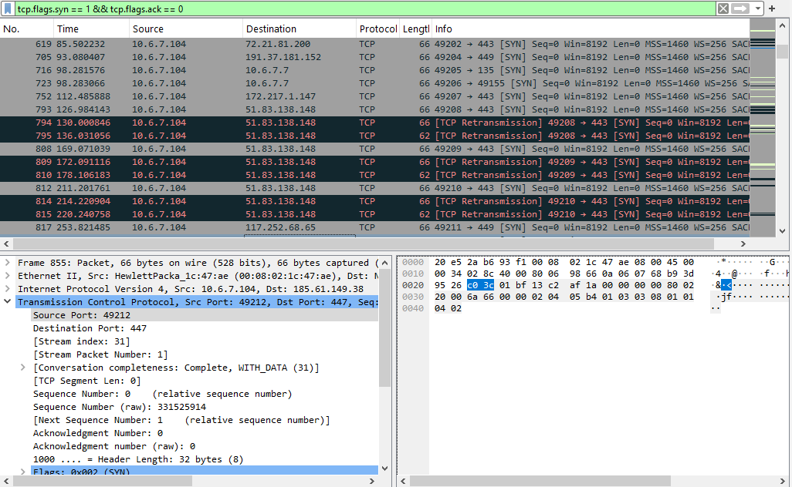
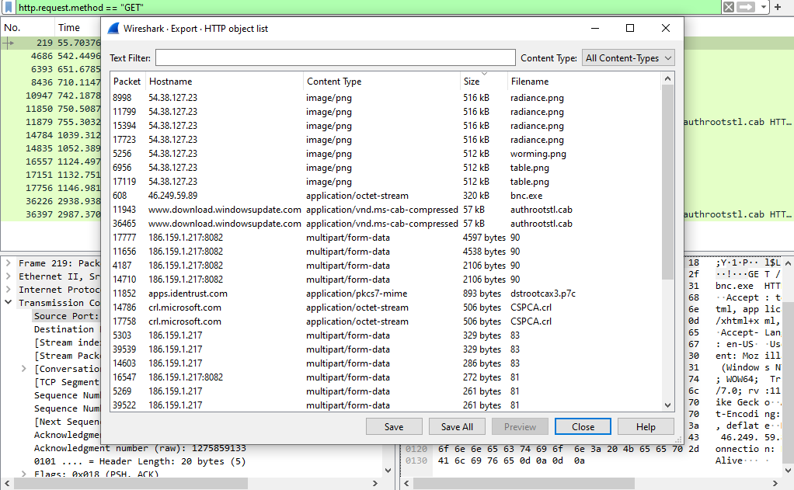
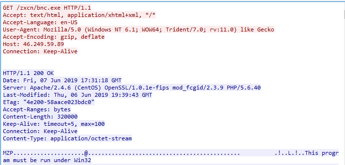
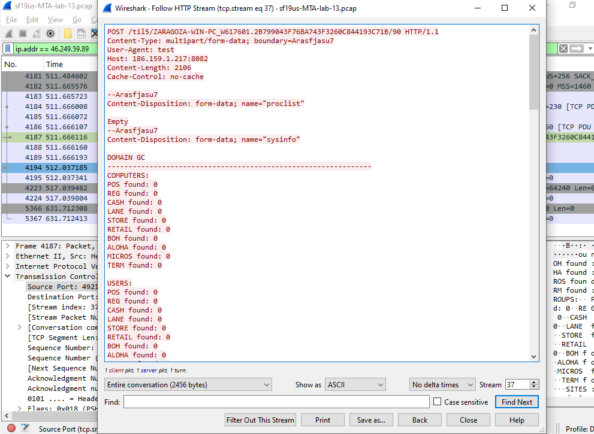

# Network Traffic Analysis of an Infected Windows Host (Wireshark)

I analyzed a packet capture (`.pcap`) from a small Windows network where one machine was infected. Using Wireshark filters and stream following, I traced what the malware did: the download of the executable, its outbound connections, and the data it sent to its command-and-control (C2) server.

**Data:** a public malware traffic exercise PCAP (lab data).
**Tools:** Wireshark.

**Hosts involved:**

| IP | Hostname | Role |
| :--- | :--- | :--- |
| 10.6.7.104 | ZARAGOZA-WIN-PC | Infected Windows 7 client |
| 10.6.7.7 | PHANTASMEDIA-DC | Domain controller (also seen talking to the C2) |
| 46.249.59.89 | | Served the malicious `.exe` |
| 186.159.1.217:8082 | | C2 server receiving the stolen data |

---

## MITRE ATT&CK

| Technique | ID | Evidence |
| :--- | :--- | :--- |
| User Execution: Malicious File | `T1204.002` | `bnc.exe` downloaded over HTTP |
| Non-Standard Port | `T1571` | Outbound connections on TCP 447, 449 and 8082 |
| Application Layer Protocol: Web | `T1071.001` | HTTP POSTs to the C2 |
| System Information Discovery / Process Discovery | `T1082` / `T1057` | `sysinfo` and `proclist` data sent to the C2 |

---

## 1. Outbound connection attempts

```text
tcp.flags.syn == 1 && tcp.flags.ack == 0
```

This filter shows only connection starts (SYN packets). From **10.6.7.104** I saw:

- Repeated SYNs and **retransmissions** to **51.83.138.148:443** (frames 794–815), meaning the server wasn't answering.
- New connections to **117.252.68.65:449** (frame 817) and **185.61.149.38:447** (frame 855).
- Connections to the domain controller **10.6.7.7** on 135 and 49155 (RPC), which is normal in a Windows domain.

At first I labeled this a port scan, but looking closer it isn't one: a scan hits many ports or hosts quickly, and here it's a handful of external IPs on unusual ports (447/449). It looks more like the malware trying to reach its C2 servers. Ports 447 and 449 are commonly associated with TrickBot.



---

## 2. Malware download

```text
http.request.method == "GET"
File → Export Objects → HTTP
```

Packet **608**: the infected host downloaded **bnc.exe** (~320 kB, `application/octet-stream`) over plain HTTP from **46.249.59.89**. The HTTP object list also showed repeated `multipart/form-data` uploads to **186.159.1.217:8082**, which I followed in step 4.



---

## 3. Confirming it's an executable

```text
ip.addr == 46.249.59.89
Follow → HTTP Stream
```

- Request: `GET /zxcn/bnc.exe`
- User-Agent: `Mozilla/5.0 (Windows NT 6.1; WOW64; Trident/7.0; rv:11.0) like Gecko`, so the victim is Windows 7 64-bit with Internet Explorer 11.
- Response body starts with `MZ` (`4D 5A`) and contains "This program must be run under Win32", which is the header of a Windows executable.
- Server: Apache/2.4.6 (CentOS).



---

## 4. Data sent to the C2

```text
http.request.method == "POST"
Follow → HTTP Stream (packet 4187, stream 37)
```

Both **10.6.7.104** and the domain controller **10.6.7.7** sent HTTP POSTs to **186.159.1.217:8082** with the User-Agent `test`. The body is `multipart/form-data` containing:

- `proclist`: the list of running processes
- `sysinfo`: system information

The data also includes checks for point-of-sale and retail keywords (`POS`, `REG`, `CASH`, `LANE`, `STORE`, `RETAIL`, `MICROS`, `ALOHA`), which suggests the attacker wanted to know whether the network has payment systems.

The fact that the **domain controller** is also sending data to the C2 makes this much more serious: the infection has spread beyond one workstation.



---

## IOCs

| Type | Value |
| :--- | :--- |
| Download IP | 46.249.59.89 |
| File | `bnc.exe` (`/zxcn/bnc.exe`) |
| C2 | 186.159.1.217:8082 |
| Other contacted IPs | 51.83.138.148:443, 117.252.68.65:449, 185.61.149.38:447 |
| User-Agent | `test` |

## Recommended response

1. Isolate **10.6.7.104** and the domain controller **10.6.7.7**.
2. Block the IPs above at the firewall.
3. Reset credentials, since this malware family is known for stealing them and a DC is involved.
4. Search other hosts for connections to the same IPs.

**Author:** Alejandro José Vargas
